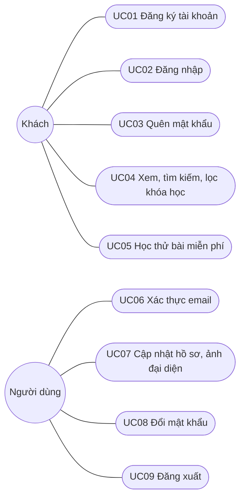
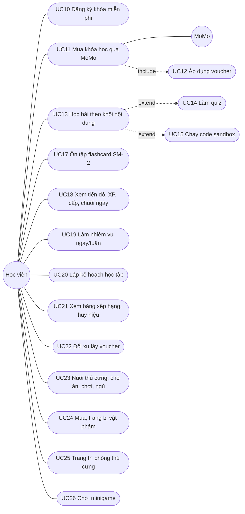
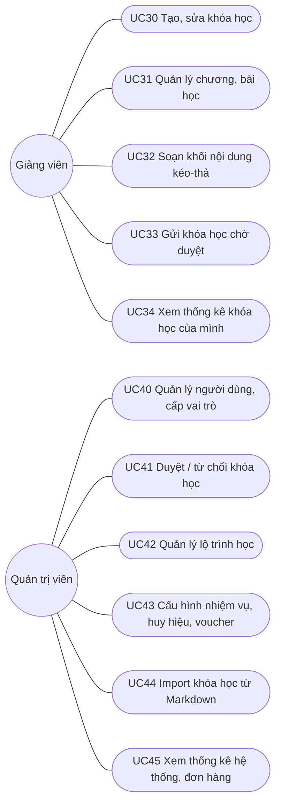
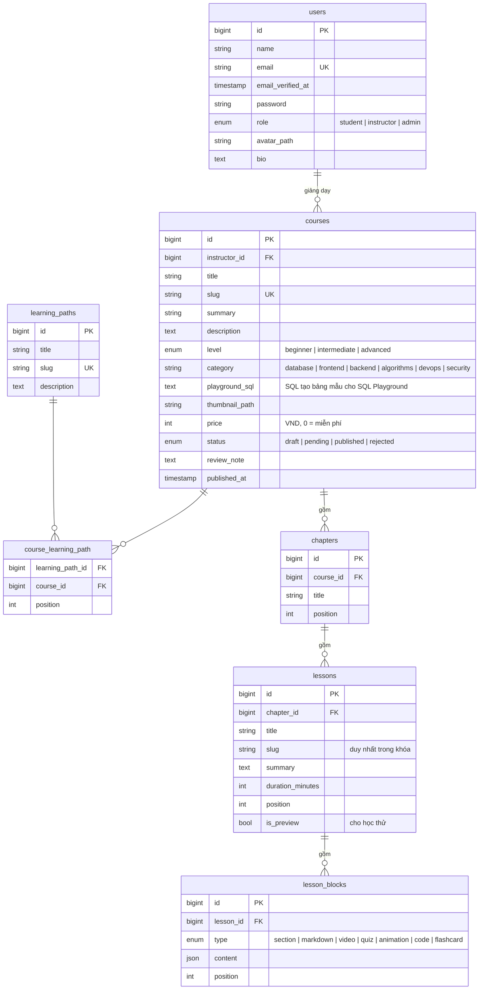
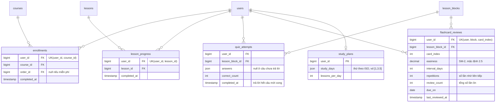
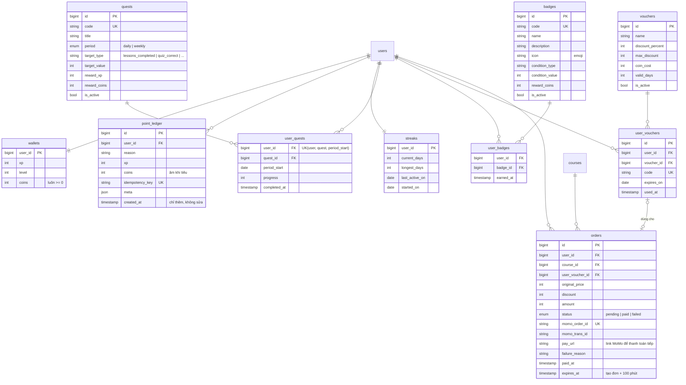
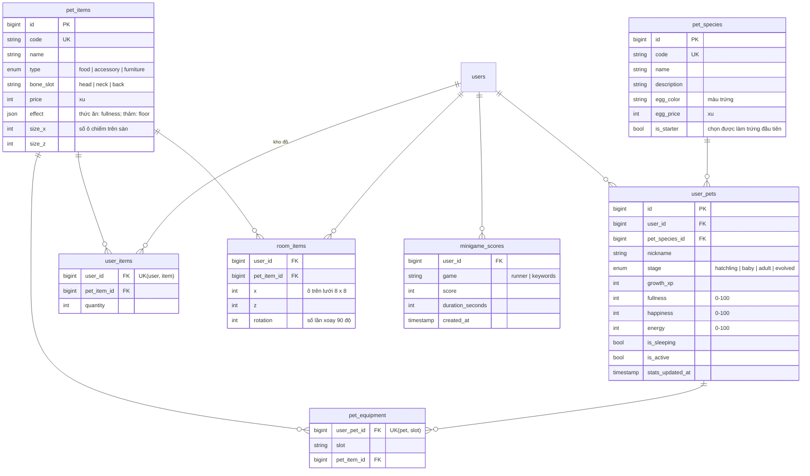
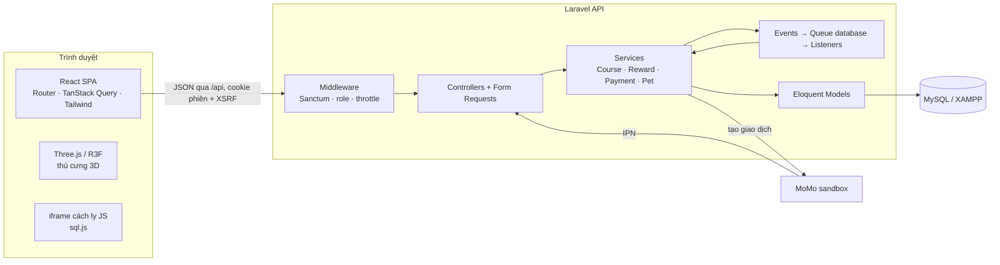

# Phân tích & thiết kế hệ thống EduQuest

Tài liệu Đợt 1 (19–25/10): tác nhân, Use Case, ERD, kiến trúc. Quy tắc thưởng xem [quy-tac-thuong.md](quy-tac-thuong.md).

## 1. Tác nhân

| Tác nhân | Mô tả |
| --- | --- |
| Khách | Chưa đăng nhập: xem trang chủ, danh sách và chi tiết khóa học, bài học thử |
| Học viên | Học bài, ôn flashcard, nhận thưởng, nuôi thú cưng, mua khóa học |
| Giảng viên | Học viên được quản trị viên cấp quyền; soạn khóa học, chương, bài, khối nội dung |
| Quản trị viên | Quản lý người dùng, duyệt khóa học, cấu hình nhiệm vụ/huy hiệu/voucher, xem thống kê |
| MoMo (hệ thống ngoài) | Cổng thanh toán sandbox, gọi IPN báo kết quả giao dịch |
| Bộ lập lịch (hệ thống) | Chạy định kỳ: làm mới nhiệm vụ, giảm chỉ số thú cưng, chốt bảng xếp hạng tuần |

Học viên, Giảng viên, Quản trị viên kế thừa "Người dùng đã đăng nhập" (đăng nhập, đăng xuất, hồ sơ, đổi mật khẩu).

## 2. Use Case

### 2.1 Khách và người dùng đã đăng nhập



### 2.2 Học viên



### 2.3 Giảng viên và Quản trị viên



### 2.4 Đặc tả Use Case chính

**UC13 – Học bài theo khối nội dung**

| Mục | Nội dung |
| --- | --- |
| Tác nhân | Học viên (đã đăng ký khóa) |
| Tiền điều kiện | Đã đăng nhập, đã đăng ký khóa học (hoặc bài cho học thử) |
| Luồng chính | 1. Mở bài học → 2. Hệ thống tải danh sách khối theo thứ tự → 3. Học viên lần lượt xem văn bản, video, làm quiz, chạy code → 4. Bấm "Hoàn thành bài" → 5. Hệ thống ghi tiến độ, bắn sự kiện `LessonCompleted` → 6. Listener phát XP, xu, cập nhật chuỗi ngày, nhiệm vụ, chỉ số thú cưng → 7. Hiển thị phần thưởng |
| Luồng phụ | 4a. Bài đã hoàn thành trước đó: chỉ ghi tiến độ, không phát thưởng lại (khóa duy nhất trong `point_ledger`) |
| Hậu điều kiện | `lesson_progress` có bản ghi, `point_ledger` thêm tối đa một bản ghi cho mỗi quy tắc |

**UC11 – Mua khóa học qua MoMo**

| Mục | Nội dung |
| --- | --- |
| Tác nhân | Học viên, MoMo |
| Luồng chính | 1. Chọn "Mua khóa" → 2. (Tùy chọn) chọn voucher → 3. Hệ thống tạo `orders` trạng thái `pending`, gọi API MoMo lấy `payUrl` → 4. Chuyển sang trang MoMo sandbox → 5. MoMo gọi IPN về backend → 6. Kiểm tra chữ ký, cập nhật đơn `paid`, tạo `enrollments`, đánh dấu voucher đã dùng (cùng transaction) → 7. Học viên quay lại trang kết quả |
| Luồng phụ | 6a. Chữ ký sai hoặc số tiền lệch: bỏ qua, ghi log. 6b. Giao dịch thất bại: đơn `failed` kèm lý do (hủy trên MoMo, không đủ tiền…), voucher không bị trừ. 6c. Đơn chờ quá 100 phút (bằng thời hạn link thanh toán MoMo): tra cứu MoMo lần cuối rồi đóng đơn, trả voucher. 6d. Học viên bấm "Thanh toán tiếp" (dùng lại link MoMo cũ) hoặc "Hủy đơn" |
| Ràng buộc | IPN có thể gọi nhiều lần → xử lý idempotent theo `momo_order_id`, email biên nhận chỉ gửi một lần. Mỗi khóa chỉ có một đơn chờ; voucher gắn vào đơn chờ bị giữ, không dùng cho đơn khác. Tiền đã trừ thì luôn ghi danh, kể cả đơn vừa bị đóng |

**UC33/UC41 – Gửi và duyệt khóa học**

| Mục | Nội dung |
| --- | --- |
| Tác nhân | Giảng viên, Quản trị viên |
| Luồng chính | 1. Giảng viên bấm "Gửi duyệt" (khóa có ít nhất 1 bài) → trạng thái `pending` → 2. Quản trị viên xem danh sách chờ duyệt → 3. Duyệt: `published`, ghi `published_at` / Từ chối: `rejected` kèm `review_note` → 4. Giảng viên sửa khóa bị từ chối và gửi lại |
| Ràng buộc | Chỉ khóa `published` hiện với học viên. Sửa khóa đã xuất bản không cần duyệt lại (đơn giản hóa) |

## 3. ERD

Quy ước: mọi bảng có `id` và `created_at/updated_at` trừ khi ghi khác; khóa ngoại xóa theo (`cascade`) với dữ liệu con. Bảng mặc định của Laravel (`sessions`, `cache`, `jobs`, `password_reset_tokens`…) không vẽ.

### 3.1 Tài khoản & nội dung



### 3.2 Học tập



### 3.3 Trò chơi hóa & thanh toán



### 3.4 Thú cưng



## 4. Kiến trúc

### 4.1 Tổng thể



- **SPA + API:** React gọi `/api/*` bằng cookie phiên Sanctum (khi dev, Vite proxy về `php artisan serve`; khi deploy, cùng domain).
- **Controller mỏng:** nhận request đã kiểm tra bởi Form Request, gọi Service, trả JSON (API Resource khi cần ẩn trường).
- **Service:** chứa nghiệp vụ và transaction. Không có tầng Repository.
- **Phân quyền:** cột `users.role` + Gate (`can:admin`, `can:teach`) cho nhóm route; Gate `manage-course` kiểm tra quyền sở hữu khóa học.
- **Hàng đợi `database`:** phát thưởng chạy qua Listener trong hàng đợi, khi dev cần chạy thêm `php artisan queue:work`. Chỉ số thú cưng (giảm theo giờ) và kỳ nhiệm vụ ngày/tuần được tính lại khi đọc nên không cần lịch chạy.

### 4.2 Luồng phát thưởng

```mermaid
sequenceDiagram
  participant FE as React
  participant LC as LearningController
  participant PS as LearningService
  participant Q as Queue (database)
  participant L as GrantLessonRewards (Listener)
  participant RS as RewardService
  participant DB as MySQL
  FE->>LC: POST /api/lessons/{id}/complete
  LC->>PS: completeLesson(user, lesson)
  PS->>DB: insert lesson_progress (bỏ qua nếu đã có)
  PS-->>Q: event LessonCompleted
  LC-->>FE: 200 {completed: true}
  Q->>L: handle(event)
  L->>RS: grant(user, "lesson_completed:{user}:{lesson}", xp, coins)
  RS->>DB: BEGIN; insert point_ledger (UK idempotency_key); update wallets; COMMIT
  Note over RS,DB: Trùng khóa → bỏ qua, không cộng lần 2
```

### 4.3 Cấu trúc mã nguồn

```
backend/app/Http/Controllers   mỗi tính năng 1 controller (AuthController, CourseController…)
backend/app/Http/Requests      kiểm tra dữ liệu gửi lên
backend/app/Services           CourseService, RewardService, PaymentService, PetService
backend/app/Providers          AppServiceProvider: Gate admin, teach, manage-course (quyền sở hữu khóa)
frontend/src/features/<tính năng>   trang + component + api.js của tính năng
frontend/src/components        component dùng chung (ui.jsx…)
```
